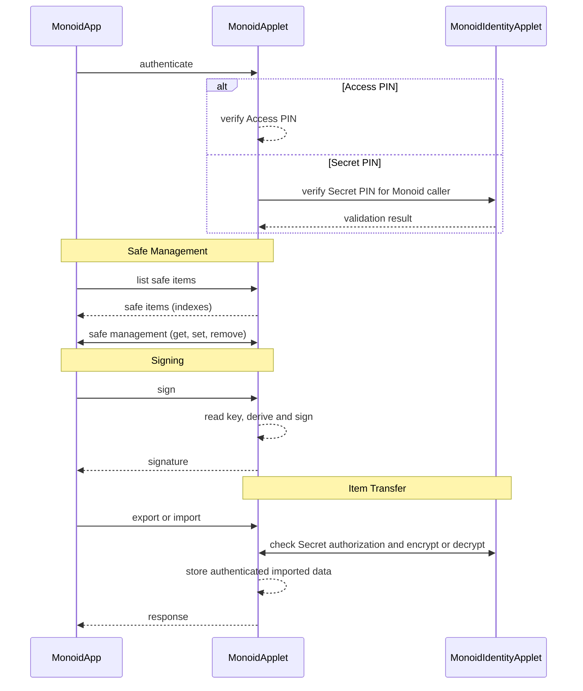

# Monoid Architecture

See [security boundaries](security.md) for the trust model and audit baseline.

## AIDs

<!-- @inplate
AIDs use the namespace `{{hex MONOID_NAMESPACE uppercase=true}}`, followed by a one-byte package number.
Applet AIDs append a one-byte applet number; software versions are independent of AIDs.
-->

AIDs use the namespace `F06D6F6E6F6964`, followed by a one-byte package number.
Applet AIDs append a one-byte applet number; software versions are independent of AIDs.

<!-- @end -->

<!-- @inplate
| Component | Package AID | Applet AID |
| --- | --- | --- |
| Monoid Identity | `{{hex MONOID_IDENTITY_PACKAGE_AID uppercase=true}}` | `{{hex MONOID_IDENTITY_AID uppercase=true}}` |
| Monoid | `{{hex MONOID_PACKAGE_AID uppercase=true}}` | `{{hex MONOID_AID uppercase=true}}` |
| Monoid Security Key | `{{hex MONOID_SECURITY_KEY_PACKAGE_AID uppercase=true}}` | `{{hex MONOID_SECURITY_KEY_AID uppercase=true}}` |
| Monoid OTP | `{{hex MONOID_OTP_PACKAGE_AID uppercase=true}}` | `{{hex MONOID_OTP_AID uppercase=true}}` |
| Monoid Library | `{{hex MONOID_LIB_PACKAGE_AID uppercase=true}}` | — |
-->

| Component           | Package AID        | Applet AID           |
| ------------------- | ------------------ | -------------------- |
| Monoid Identity     | `F06D6F6E6F696400` | `F06D6F6E6F69640001` |
| Monoid              | `F06D6F6E6F696402` | `F06D6F6E6F69640201` |
| Monoid Security Key | `F06D6F6E6F696403` | `A0000006472F0001`   |
| Monoid OTP          | `F06D6F6E6F696405` | `F06D6F6E6F69640501` |
| Monoid Library      | `F06D6F6E6F696404` | —                    |

<!-- @end -->

Security Key uses the standard FIDO NFC instance AID; its CAP module AID follows
the Monoid package namespace. Install Identity, load Monoid Library, then install
Monoid, then the optional Security Key and OTP applets. The library has no applet instance.
Monoid owns Safe item storage, Access PIN, derivation and signing in one applet
context. Monoid Identity keeps its key pair, Card ID, Secret PIN and optional
Bundle across Monoid replacement. It verifies Secret PIN and performs complete
item encryption and decryption, enforcing caller authorization and Bundle policy
internally. See
[Monoid Identity](identity.md) for its card-local interface and [Bundle](bundle.md)
for enrollment and two-member extension. An optional Authority public key supplied
at Identity installation authenticates [issued Bundle tokens](authority.md).
Identity retains the token's `allowPeerExtension` policy and enforces it at both
extension entry points.

Monoid, Security Key and OTP share CBOR parsing, map indexing, APDU reception, response
storage and segmented sending through the library. Monoid and OTP also share
short-APDU framing, header validation and GET RESPONSE in `monoidlib.ApduTransport`;
their subclasses only select and execute commands. Security Key keeps CTAP framing
and status mapping in its own transport. Commands run only after the complete
request arrives; each applet owns its transport state and buffers. Identity does
not import the library. The library also provides stateless security checks and
byte-array utilities; authentication state and private arrays remain owned by
the calling applet. Identity keeps its own generated security-check implementation.
Replacing the library requires first removing its dependent OTP, Security Key and Monoid packages;
Identity can remain installed.

[OTP](otp.md) owns TOTP configuration interpretation and batch state. Monoid
computes HMAC with an explicitly granted built-in key or a custom item mapped to
HMAC and authorized by its exact type's read grant, without returning the shared secret;
Identity verifies signed time against its installed Authority public key.
HMAC reuses native SHA-1/256/512 digest engines and one 128-byte transient pad.
Inputs and results use persistent storage; repeated pad writes stay in RAM.

The installation script defaults to `Install`, which does not delete installed
applets. Explicit `ReinstallMonoid` clears all Safe items and Access PIN while
preserving Identity and Secret PIN. Bundle exports must be recovered through
another member; the originating Identity cannot decrypt its own Bundle artifact.

## Persistent storage

Safe checks the card's available persistent space before allocating a new
item, replacement data or a non-null alias. Less than the estimated allocation
plus 4096 bytes returns `6A84`. The reserve is defined by
`Safe.MIN_AVAILABLE_PERSISTENT_MEMORY`.

The estimate includes the new byte arrays and, when required, the full replacement
item directory at two bytes per reference. Object headers and alignment are
absorbed by the reserve; there is no check after allocation.

The rejected Safe write leaves its existing value intact. Set applies data/secret
and alias separately; an alias failure does not undo an earlier data update.
Deletion, clearing an alias and changing only the secret flag do not allocate
replacement storage and remain available below the threshold.

This is a write guard, not a reserved memory partition. Temporary objects and
other applets can consume the remaining space; old values awaiting collection
also count as occupied when checking a replacement.

## Item data

The built-in key types include `0x0301` (secp256k1), `0x0302` (secp256r1),
`0x0401` (Ed25519) and `0x05LL` (HMAC, `LL` is the 1–255-byte key length).
Removing the former master type shifted the curve categories.
Indices and exported items using the former master or curve types cannot be
reused unchanged; in particular, the former secp256k1 type `0x0401` now denotes
Ed25519. There is no automatic conversion of these former types.

Safe also has a fixed table of custom types mapped to built-in key kinds. Its only
entry is `0xF201` → HMAC (SHA-1/256/512). An OTP account is one secret item:
data is the 1–255-byte HMAC secret, metadata is the five-byte account configuration,
and alias is the label. Its index is `F2 01 || SHA-256(secret)[0:8]`, using the
built-in HMAC digest-index path; supplied indices and replacement data must match.
The same secret cannot create a second account. The secret flag cannot be cleared;
Get/client reads fail and Export only returns the existing encrypted envelope.
Read access to this exact custom type permits HMAC use; explicit HMAC `keys`
grants do not cover it. See [OTP](otp.md) for configuration and authorization.

Each item stores its data in one persistent byte array. The internal
`SafeDataSource` abstract class provides a length, repeatable range reads into a
supplied buffer and persistent copying in 256-byte chunks. Stored-data reads
check Safe authorization. Create and Set copy input into new persistent arrays,
then publish the completed replacement.
Data and secret change atomically; alias updates remain separate.

Get and Export use the existing response transport. Responses fitting in one
256-byte packet borrow the APDU buffer; larger data is read through a fixed
window as GET RESPONSE advances. Large metadata or alias fields can still require
a larger window. Small signing keys are materialized only when the signing or
derivation operation needs them.

Export and Import keep their complete cryptographic work buffer private to Identity.
Input snapshots and complete results use temporary persistent arrays. Cryptographic
working state and bounded cross-applet buffers remain in transient memory.
Identity shares one AES-GCM engine and HMAC workspace between communication and
item encryption. Native AES key containers use persistent storage and are
set before each operation; authorization remains transient.
`CommunicationDataShareable` transfers bounded ranges across the applet boundary;
completed results admit only the original caller. Import verifies the complete
artifact before publishing data. These operations
therefore need temporary persistent space in addition to the stored item.

The complete-request limit is 8192 bytes.

## Derivation cache

BIP32, SLIP-0010 Ed25519 and Monoid-001 share 32 persistent FIFO entries.
Each entry matches the algorithm, source seed bytes and
complete path or context. A hit skips both seed-to-master and path derivation.
Different paths have separate entries; intermediate path prefixes are not cached.
Entries for the same algorithm and seed share a private immutable seed snapshot
and seed-derived master. A new path can reuse that master while any matching
result remains among the same 32 slots. There is no separate master cache.

Each entry holds the final derived key and lazily caches its public key.
Ed25519 also retains the expanded scalar and signing prefix. Working key copies
and native EC/HMAC key containers use persistent storage. Ed25519 validity still expires
on reset or deselection; every native operation reloads its key through the current
authorized request. Signature nonces are computed for every message.

Commands still authorize access and read the current Safe item before lookup.
Changed source bytes miss the cache, and removed items cannot use it. Taproot
adjustments apply only to a working copy. Cached material remains until FIFO
eviction, `0xFF Reset` or Monoid removal; hits do not refresh the eviction order.
New result publication requests collection of derivation temporaries and evicted
entries; warm hits do not request collection.
Weierstrass public-key reuse currently serves ordinary ViewKey; BIP340 and
Taproot operations still compute the public keys needed for their adjustments.

## Authorization

Access PIN and Secret PIN retain separate command permissions. Commands validate
authorization before opening internal Safe access; Secret PIN must be set and
unblocked. Identity owns Secret PIN, retries and caller-bound authorization.
Encryption, decryption and Bundle management verify that authorization inside
Identity. An Access-authorized storage operation does not establish Secret
authorization. Monoid does not retain a copy of Secret PIN.

Ordinary APDU authorization clears on deselection, card reset and successful
`0xFF Reset`. Identity Secret authorization is caller-bound and reset-scoped, so
ordinary SELECT switches do not clear it or authorize a different caller. A new
Secret PIN check or update clears its previous authorization. Verifying a PIN checks both
the native `OwnerPIN` result and validation flag before publishing redundant
authorization state; subsequent access checks repeat three times. Only successful
Secret PIN authentication resets its failed-attempt counter during normal use. Access-authenticated
storage operations do not reset that counter.

`0xFF Reset` requires no PIN. It clears all items, derivation cache, Bundle, both
PINs and current authorization, returning Monoid to an uninitialized state. It
preserves the Card ID and installed Authority key, generates a new Identity key pair
and binding secret, clears the token cache
and atomically updates Monoid's binding with these changes. This also clears
blocked-PIN state; new PIN initialization is required before ordinary storage use.
It does not replace either installed applet instance or its code. A card power
reset and Monoid reinstallation preserve Identity instead.

Safe storage, item objects and derivation caches belong to Monoid's applet
context. They no longer expose a separate Safe Shareable interface. Replacing
Monoid removes those objects and Access PIN. Identity retains Secret PIN and its
retry state; replacement Monoid code cannot initialize a different Secret PIN
without first authenticating the configured one or resetting the entire Identity.

Identity remains a separate applet. It provides caller-specific binding tokens
and encrypted transfer to other applets, with full runtime caller AIDs separating
their cryptographic domains. Only the exact Monoid AID can create, join or extend
a Bundle. A initiates with `0x25 Extend Bundle`, B confirms with
`0x26 Approve Bundle Extension` and C joins with `0x24 Join Bundle`. B's response
is C's complete Join request. Approval
requires another Identity's signature together with a Bundle-root HMAC, local
Secret authorization and `allowPeerExtension`; it preserves the root and policy. Stored
enrollment snapshots are not authorization lists, so new members can exchange
records and, when permitted, participate in later extensions without synchronizing
older cards.
Monoid privately binds its Identity token before processing its first command;
later Identity calls must match that token. Replacing Identity cannot automatically
rebind a Monoid that retains its data. Only `0xFF Reset` explicitly synchronizes a
new binding while removing the protected data; other applets' old binding tokens
remain invalid until they perform their own explicit reinitialization.
AIDs identify applications, not their code.
Preserving Identity, Secret PIN and Bundle permits recovery of other members'
exported items after Monoid reinstallation, subject to Secret authentication and the
[two-card data migration boundary](bundle.md#recovery-and-data-migration).
Hello exposes the stable Identity ID and public key,
the Bundle key hash or `false`, and both PIN try counters. Cryptographic capability
declarations are returned by System Information. Both commands report the software
version from an independent build constant, not from the instance AID.
Applet grants are managed by `0x50` List, `0x51` Set and `0x52` Remove, all under
Access or Secret PIN authorization. Monoid owns the grant directory separately from Safe
items; replacement is atomic and Reset clears it with the other Monoid state.
The optional exact-Type permissions, fixed Key descriptors and single seed/domain
are independent. Read permission for a custom type mapped to a key kind also
permits use of that kind; it never exposes secret data. Clients expose
`monoid.MonoidClientShareable` to supply their installation-token hash.
Public interfaces live in `monoid.cap`, so client CAPs
import that package and must be removed before replacing its code package.
Authenticated `Monoid` sessions expose the granted seed's Monoid-001/P-256 public
key and digest signature, plus Type-restricted item handles. Session authorization
is independent of APDU PIN state. Reset, grant replacement and revocation invalidate
old sessions and handles. `removeAll(type)` requires the exact Type's writable
grant and atomically replaces the item directory, including when no items match.
SIO parameter `1` may reuse the same caller/current-grant session, clearing its
authentication on every acquisition; parameter `0` keeps independent sessions.
Range overloads and direct `readData`, `nextData`, `listIndices` and `createData`
operations avoid intermediate handles where possible. Existing handles remain
available for longer stable reads; [the interface contracts](security-key.md#monoid-interface)
define filtering, capacities and overlapping-buffer rules.
The Security Key client reduces duplicate resident records for the same RP/user
to one retained old record, commits a new record, then removes the old record.
Duplicate cleanup requests GC without guaranteeing immediate space reclamation.
Its local Reset commits credential removal before clearing its own PIN. Both
workflows converge on a successful retry rather than sharing an outer transaction;
each registration retry uses a new random credential ID. See
[Security Key](security-key.md) for the CTAP2.0 client.
