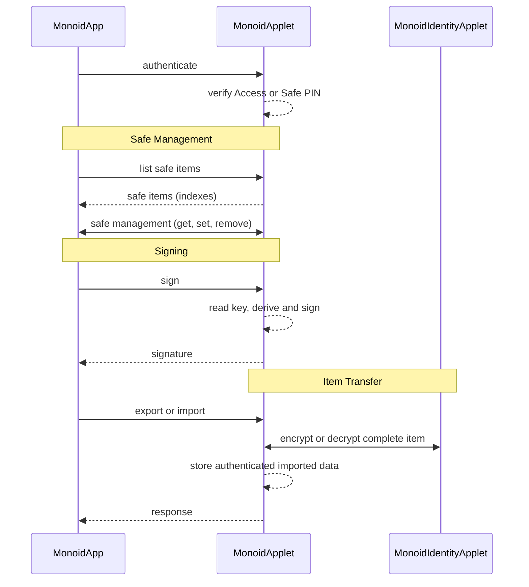

# Monoid Architecture

## AIDs

<!-- @inplate
AIDs use the namespace `{{hex MONOID_NAMESPACE uppercase=true}}`, followed by a one-byte package number.
Applet AIDs append a one-byte applet number; software versions are independent of AIDs.
-->

AIDs use the namespace `F06D6F6E6F6964`, followed by a one-byte package number.
Applet AIDs append a one-byte applet number; software versions are independent of AIDs.

<!-- @end -->

<!-- @inplate
| Component | Package AID | Applet AID |
| --- | --- | --- |
| Monoid Identity | `{{hex MONOID_IDENTITY_PACKAGE_AID uppercase=true}}` | `{{hex MONOID_IDENTITY_AID uppercase=true}}` |
| Monoid | `{{hex MONOID_PACKAGE_AID uppercase=true}}` | `{{hex MONOID_AID uppercase=true}}` |
-->

| Component       | Package AID        | Applet AID           |
| --------------- | ------------------ | -------------------- |
| Monoid Identity | `F06D6F6E6F696400` | `F06D6F6E6F69640001` |
| Monoid          | `F06D6F6E6F696402` | `F06D6F6E6F69640201` |

<!-- @end -->

Identity and Monoid use separate CAP files. Install Identity before Monoid.
Monoid owns Safe item storage, both PINs, derivation and signing in one applet
context. Monoid Identity keeps its key pair, random ID and optional Bundle across
Monoid replacement; it has no PIN or authorization session. It performs complete
item encryption and decryption, enforcing Bundle export policy internally. See
[Monoid Identity](identity.md) for its card-local interface and [Bundle](bundle.md)
for fixed membership and enrollment.

The installation script defaults to `Install`, which does not delete installed
applets. Explicit `ReinstallMonoid` clears all Safe items and both PINs while
preserving Identity. Export items before reinstallation and import them afterward.

## Persistent storage

Safe checks the card's available persistent space before allocating a new
item, replacement data or a non-null alias. Less than the estimated allocation
plus 4096 bytes returns `6A84`. The reserve is defined by
`Safe.MIN_AVAILABLE_PERSISTENT_MEMORY`.

The estimate includes the new byte arrays and, when required, the full replacement
item directory at two bytes per reference. Object headers and alignment are
absorbed by the reserve; there is no check after allocation.

The rejected Safe write leaves its existing value intact. Set applies data/secret
and alias separately; an alias failure does not undo an earlier data update.
Deletion, clearing an alias and changing only the secret flag do not allocate
replacement storage and remain available below the threshold.

This is a write guard, not a reserved memory partition. Temporary objects and
other applets can consume the remaining space; old values awaiting collection
also count as occupied when checking a replacement.

## Item data

The built-in key types are `0x0301` (secp256k1), `0x0302` (secp256r1) and
`0x0401` (Ed25519). Removing the former master type shifted these categories.
Indices and exported items using the former master or curve types cannot be
reused unchanged; in particular, the former secp256k1 type `0x0401` now denotes
Ed25519. There is no automatic conversion of these former types.

Each item stores its data in one persistent byte array. The internal
`SafeDataSource` interface provides a length and repeatable range reads into a
supplied buffer. Stored-data reads check Safe authorization. Create and Set copy
input into new persistent arrays, then publish the completed replacement.
Data and secret change atomically; alias updates remain separate.

Get and Export use the existing response transport. Responses fitting in one
256-byte packet borrow the APDU buffer; larger data is read through a fixed
window as GET RESPONSE advances. Large key or alias metadata can still require
a larger window. Small signing keys are materialized only when the signing or
derivation operation needs them.

Export and Import keep their complete cryptographic work buffer private to Identity.
Input snapshots and complete results use temporary persistent arrays. Cryptographic
working state and bounded cross-applet buffers remain in transient memory.
`CommunicationDataShareable` transfers bounded ranges across the applet boundary;
completed results admit only the original caller. Import verifies the complete
artifact before publishing data. These operations
therefore need temporary persistent space in addition to the stored item.

The complete-request limit is 8192 bytes.

## Derivation cache

BIP32, SLIP-0010 Ed25519 and Monoid-001 share 32 persistent FIFO entries.
Each entry matches the algorithm, source seed bytes and
complete path or context. A hit skips both seed-to-master and path derivation.
Different paths have separate entries; intermediate path prefixes are not cached.

Each entry holds the final derived key and lazily caches its public key.
Ed25519 also retains the expanded scalar and signing prefix. Reset or deselection
invalidates transient working keys; subsequent operations restore them from the
persistent result. Signature nonces are computed for every message.

Commands still authorize access and read the current Safe item before lookup.
Changed source bytes miss the cache, and removed items cannot use it. Taproot
adjustments apply only to a working copy. Cached material remains until FIFO
eviction or Monoid removal; hits do not refresh the eviction order.
Weierstrass public-key reuse currently serves ordinary ViewKey; BIP340 and
Taproot operations still compute the public keys needed for their adjustments.

## Authorization

Access PIN and Safe PIN retain their separate command permissions. Commands
validate their current authorization before opening internal Safe access; the
Safe PIN must be set and unblocked. Sensitive commands additionally require Safe
PIN authorization. Monoid does not persist a copy of the Safe PIN or automatically
reverify it during ordinary storage access.

Ordinary APDU authorization clears on deselection. Verifying a PIN checks both
the native `OwnerPIN` result and validation flag before publishing redundant
authorization state; subsequent access checks repeat three times. Only successful
Safe PIN authentication resets its failed-attempt counter. Access-authenticated
storage operations do not reset that counter.

Safe storage, item objects and derivation caches belong to Monoid's applet
context. They no longer expose a separate Safe Shareable interface. Replacing
Monoid removes those objects together with both PINs; a replacement applet cannot
use the old Safe PIN to access a surviving standalone Safe.

Identity remains a separate applet. It provides caller-specific binding tokens
and encrypted transfer to other applets, with full runtime caller AIDs separating
their cryptographic domains. Only the exact Monoid AID can manage Bundle membership.
Monoid privately binds its Identity token before processing its first command;
later Identity calls must match that token. Replacing Identity cannot automatically
rebind a Monoid that retains its data. AIDs identify applications, not their code.
Preserving Identity and its Bundle state permits recovery of the corresponding
exported items after Monoid reinstallation, including the accepted
[two-card data migration boundary](bundle.md#recovery-and-data-migration).
Hello exposes the stable Identity ID and public key,
the Bundle key hash or `false`, and both PIN try counters. Cryptographic capability
declarations are returned by System Information. Both commands report the software
version from an independent build constant, not from the instance AID.
Third-party authorization and signing interfaces are not yet implemented.
