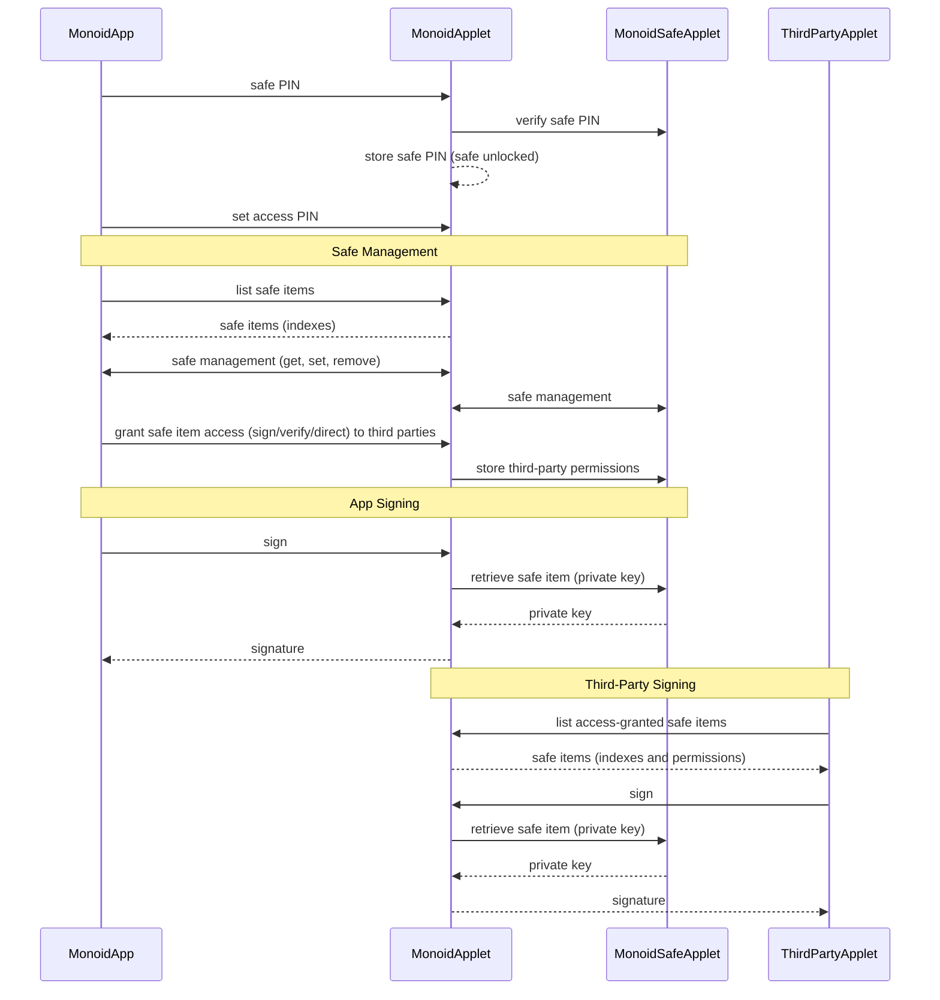

# Monoid Architecture

## Some thoughts

### Third-party applet to _Monoid Applet_ authentication nodes

> Under the assumption that third-party applets hold the credentials to access the safe via _Monoid Applet_, so upgrade or reinstallation of _Monoid Applet_ will not reset applets' access to the safe.

Applet AIDs identify applications; they do not authenticate their code. A card owner can install modified Monoid code under an accepted AID. Reinstalling Monoid removes its cached Safe PIN, but Safe must also prevent another applet from inheriting an existing authorization.

Safe returns a caller-bound session through `SafeShareable`. After initial PIN setup, data access and PIN changes require that session to verify the Safe PIN. Each caller retains its own authorization when the terminal switches between applets. Repeated interface acquisition reuses that caller's authorized session and preserves its item interfaces. Checking the PIN revokes only that caller's previous authorization; a failed check does not revoke other callers unless it exhausts the shared try counter. Updating the PIN, exhausting its try counter, or resetting the card revokes all sessions. Item interfaces belong to the session that returned them.

Safe uses one native `OwnerPIN` for the PIN value and shared try counter. It checks both the comparison result and native validation flag before publishing a session's redundant authorization state. Subsequent access checks the caller's own authorization and the shared lock state, since the native validation flag describes the most recent PIN check rather than every caller's grant. Authorization states and the links used for revocation clear on card reset.

These checks apply during continuous card power, including when a terminal switches between applets. Selecting another applet alone does not reset Safe's authorization. Other applets require terminal commands or applet calls to execute; they do not run in the background.

Session binding uses the JCRE caller AID object's identity. Preventing a replacement applet from inheriting authorization requires the runtime to issue a different AID object on reinstallation or clear transient authorization during installation. The tested card issues a different AID object even without a reset; this is a card compatibility requirement, not a portable guarantee of the Shareable API.

An applet given the correct Safe PIN can access the stored secrets. This boundary does not authenticate installed code or protect credentials supplied to a malicious replacement applet.
