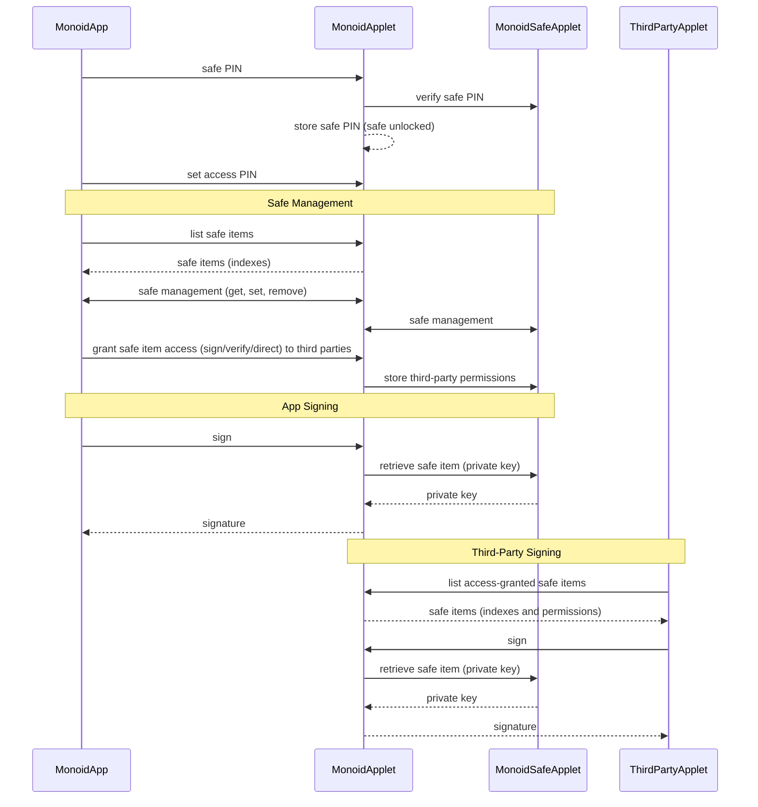

# Monoid Architecture

## AIDs

<!-- @inplate
AIDs use the namespace `{{hex MONOID_NAMESPACE uppercase=true}}`, followed by a one-byte package number.
Applet AIDs append a one-byte applet number and a two-byte version.
-->

AIDs use the namespace `F06D6F6E6F6964`, followed by a one-byte package number.
Applet AIDs append a one-byte applet number and a two-byte version.

<!-- @end -->

<!-- @inplate
| Component | Package AID | Applet AID |
| --- | --- | --- |
| Safe Identity | `{{hex MONOID_SAFE_IDENTITY_PACKAGE_AID uppercase=true}}` | `{{hex MONOID_SAFE_IDENTITY_AID uppercase=true}}` |
| Safe | `{{hex MONOID_SAFE_PACKAGE_AID uppercase=true}}` | `{{hex MONOID_SAFE_AID uppercase=true}}` |
| Monoid | `{{hex MONOID_PACKAGE_AID uppercase=true}}` | `{{hex MONOID_AID uppercase=true}}` |
-->

| Component     | Package AID        | Applet AID               |
| ------------- | ------------------ | ------------------------ |
| Safe Identity | `F06D6F6E6F696400` | `F06D6F6E6F696400010000` |
| Safe          | `F06D6F6E6F696401` | `F06D6F6E6F696401010000` |
| Monoid        | `F06D6F6E6F696402` | `F06D6F6E6F696402010000` |

<!-- @end -->

Identity, Safe and Monoid use separate CAP files, with dependencies
Monoid → Safe → Identity. Install them in the reverse order. Safe Identity keeps
its own key pair across Safe replacement; it has no PIN or authorization session.
Safe returns the persistent random ID owned by Identity. See [Safe Identity](safe-identity.md)
for its card-local interface and communication key format.

Earlier firmware used package `00` for Safe and `01` for Monoid. Migrating these
installations requires preserving the items before replacing both packages and
updating clients to select the new Monoid AID.
The new Safe AID equals the old Monoid AID; the ordinary installation script is
not a migration tool for that layout.

## Persistent storage

Safe checks the card's available persistent space once before allocating a new
item, replacement data or a non-null alias. Less than the estimated allocation
plus 4096 bytes returns `6A84`. The reserve is defined by
`MonoidSafeApplet.MIN_AVAILABLE_PERSISTENT_MEMORY`.

The estimate includes the new byte arrays and, when required, the full replacement
item directory at two bytes per reference. Object headers and alignment are
absorbed by the reserve; there is no check after allocation.

The rejected Safe write leaves its existing value intact. Set applies data/secret
and alias separately; an alias failure does not undo an earlier data update.
Deletion, clearing an alias and changing only the secret flag do not allocate
replacement storage and remain available below the threshold.

This is a write guard, not a reserved memory partition. Temporary objects and
other applets can consume the remaining space; old values awaiting collection
also count as occupied when checking a replacement.

## Derivation cache

BIP32, SLIP-0010 Ed25519 and Monoid-001 share 32 persistent FIFO entries.
Each entry matches the algorithm, source seed or master bytes, source kind and
complete path or context. A hit skips both seed-to-master and path derivation.
Different paths have separate entries; intermediate path prefixes are not cached.

Each entry holds the final derived key and lazily caches its public key.
Ed25519 also retains the expanded scalar and signing prefix. Reset or deselection
invalidates transient working keys; subsequent operations restore them from the
persistent result. Signature nonces are computed for every message.

Commands still authorize access and read the current Safe item before lookup.
Changed source bytes miss the cache, and removed items cannot use it. Taproot
adjustments apply only to a working copy. Cached material remains until FIFO
eviction or Monoid removal; hits do not refresh the eviction order.
Weierstrass public-key reuse currently serves ordinary ViewKey; BIP340 and
Taproot operations still compute the public keys needed for their adjustments.

## Some thoughts

### Third-party applet to _Monoid Applet_ authentication nodes

> Under the assumption that third-party applets hold the credentials to access the safe via _Monoid Applet_, so upgrade or reinstallation of _Monoid Applet_ will not reset applets' access to the safe.

Applet AIDs identify applications; they do not authenticate their code. A card owner can install modified Monoid code under an accepted AID. Reinstalling Monoid removes its cached Safe PIN, but Safe must also prevent another applet from inheriting an existing authorization.

Safe returns a caller-bound session through `SafeShareable`. After initial PIN setup, data access and PIN changes require that session to verify the Safe PIN. Each caller retains its own authorization when the terminal switches between applets. Repeated interface acquisition reuses that caller's authorized session and preserves its item interfaces. Checking the PIN revokes only that caller's previous authorization; a failed check does not revoke other callers unless it exhausts the shared try counter. Updating the PIN, exhausting its try counter, or resetting the card revokes all sessions. Item interfaces belong to the session that returned them.

Safe uses one native `OwnerPIN` for the PIN value and shared try counter. It checks both the comparison result and native validation flag before publishing a session's redundant authorization state. Subsequent access checks the caller's own authorization and the shared lock state, since the native validation flag describes the most recent PIN check rather than every caller's grant. Authorization states and the links used for revocation clear on card reset.

These checks apply during continuous card power, including when a terminal switches between applets. Selecting another applet alone does not reset Safe's authorization. Other applets require terminal commands or applet calls to execute; they do not run in the background.

Session binding uses the JCRE caller AID object's identity. Preventing a replacement applet from inheriting authorization requires the runtime to issue a different AID object on reinstallation or clear transient authorization during installation. The tested card issues a different AID object even without a reset; this is a card compatibility requirement, not a portable guarantee of the Shareable API.

An applet given the correct Safe PIN can access the stored secrets. This boundary does not authenticate installed code or protect credentials supplied to a malicious replacement applet.
